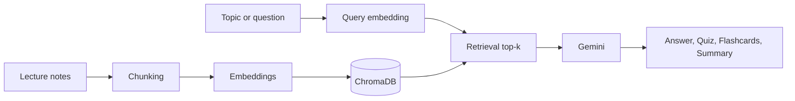

# 🎓 **NoteWise Study Companion**

**Turn your own lecture notes into an AI study partner. Ask questions, get quizzed, flip flashcards and revise with summaries, all generated only from the notes you upload.**

   

---

## **🎯 The idea**

Most students read notes again and again, which feels productive but is a weak way to learn. Testing yourself works far better. **NoteWise** reads your PDFs and text notes, finds the parts that matter for a topic, and turns them into questions, flashcards and revision points. Every output comes from **your** notes, not from the internet, so what you practise is what you will be examined on.

## **✨ What you can do**

| **Tab** | **What it gives you** |
|---|---|
| **💬 Ask** | Chat with your notes and get answers with file, page and similarity score |
| **📝 Quiz** | Multiple-choice quiz on any topic with instant scoring and explanations |
| **🗂️ Flashcards** | Front and back cards you can flip, plus a **CSV download** for Anki |
| **📌 Summary** | Short bullet-point revision sheet for a topic |

**Extra touches**

- **Grounded answers**: if your notes do not cover a topic, the app says so instead of guessing
- **Quiz validation**: broken or incomplete model output is filtered out before it reaches you
- **Live tuning**: change chunk size, overlap and top-k from the sidebar
- **Saved index**: ChromaDB stores vectors on disk, so you index once and study anytime
- **No duplicates**: uploading the same file again never repeats chunks
- **Terminal mode** and a **pytest suite** included

## **🧠 How it works**



| **Stage** | **What happens** | **File** |
|---|---|---|
| **Document processing** | Reads PDF, TXT and MD files page by page | `src/loader.py` |
| **Chunking** | Overlapping chunks split on paragraph and sentence boundaries | `src/chunker.py` |
| **Embeddings** | Meaning-aware vectors with `all-MiniLM-L6-v2` | `src/embeddings.py` |
| **Vector database** | ChromaDB with cosine similarity | `src/vector_store.py` |
| **Retrieval** | Top-k chunks with a minimum-score filter | `src/rag_pipeline.py` |
| **Study tools** | Prompts that create quizzes, flashcards and summaries | `src/study_tools.py` |
| **LLM** | Gemini connection and answer prompt | `src/llm.py` |

## **🗂️ Project structure**

```
NoteWise-Study-Companion/
├── app.py                 # Streamlit app with 4 tabs
├── cli.py                 # Terminal commands
├── requirements.txt
├── .env.example
├── sample_docs/           # Operating Systems + Machine Learning demo notes
├── src/
│   ├── config.py
│   ├── loader.py
│   ├── chunker.py
│   ├── embeddings.py
│   ├── vector_store.py
│   ├── rag_pipeline.py
│   ├── llm.py
│   └── study_tools.py
└── tests/
    └── test_notewise.py
```

## **🚀 Getting started**

**1. Clone and install**

```bash
git clone https://github.com/MariaZafar22/NoteWise-Study-Companion.git
cd NoteWise-Study-Companion
python -m venv venv
venv\Scripts\activate        # Windows
# source venv/bin/activate   # macOS / Linux
pip install -r requirements.txt
```

**2. Add your Gemini key**

```bash
copy .env.example .env       # Windows
# cp .env.example .env       # macOS / Linux
```

Open `.env` and set `GEMINI_API_KEY`. A free key is available from [Google AI Studio](https://aistudio.google.com/apikey).

**3. Run**

```bash
streamlit run app.py
```

Upload your notes, press **Build study index**, then open any tab. The first run downloads the small embedding model once (about 90 MB).

**Terminal examples**

```bash
python cli.py ingest sample_docs
python cli.py ask "What are the four conditions of deadlock?"
python cli.py quiz "overfitting" -n 3
python cli.py cards "paging"
python cli.py summary "CPU scheduling"
```

## **💡 Try it with the sample notes**

- **Ask:** *What is the difference between a process and a thread?*
- **Quiz:** *deadlocks*, *overfitting*, *precision and recall*
- **Flashcards:** *paging*, *gradient descent*
- **Summary:** *CPU scheduling*

## **🔧 Tuning retrieval**

| **Setting** | **Effect** |
|---|---|
| **Chunk size** | Small chunks match precisely, large chunks keep more context |
| **Overlap** | Keeps a sentence whole when a chunk boundary cuts through it |
| **Top-k** | More passages give richer quizzes but add noise |
| **MIN_SCORE** | Higher value means stricter relevance |

## **🧪 Tests**

```bash
python -m pytest -q
```

Covers chunking, retrieval accuracy, duplicate protection, no-notes behaviour, JSON parsing and quiz validation.

## **🛠️ Tech stack**

**Python** · **Streamlit** · **ChromaDB** · **sentence-transformers** · **Google Gemini** · **pypdf** · **pytest**

## **🔮 Next ideas**

- Spaced-repetition schedule for weak topics
- Past-paper mode that mimics exam question style
- Urdu and Roman Urdu explanations of difficult topics

---

**👩‍💻 Built by Maria Zafar**

**GitHub:** [MariaZafar22](https://github.com/MariaZafar22) · **LinkedIn:** [MariaZafar22](https://linkedin.com/in/MariaZafar22)


